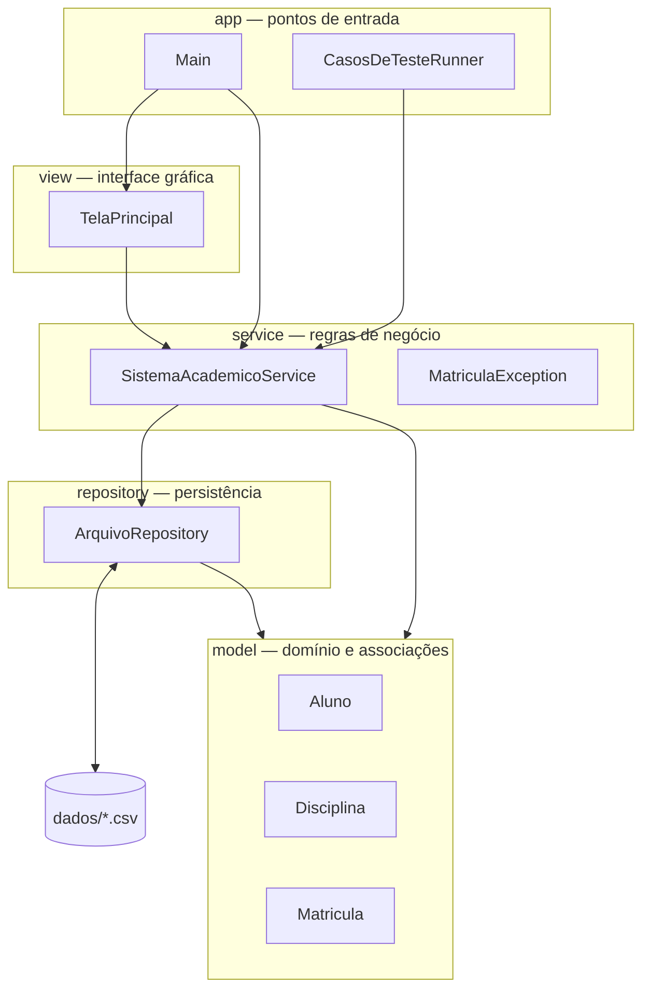
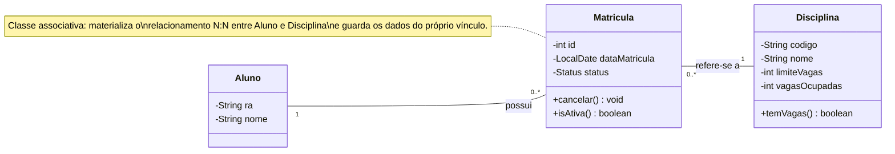
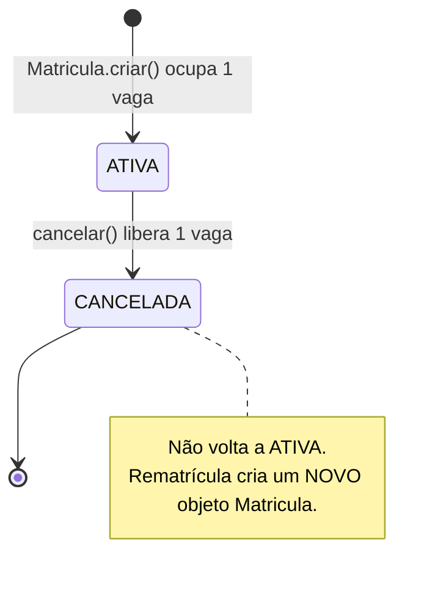
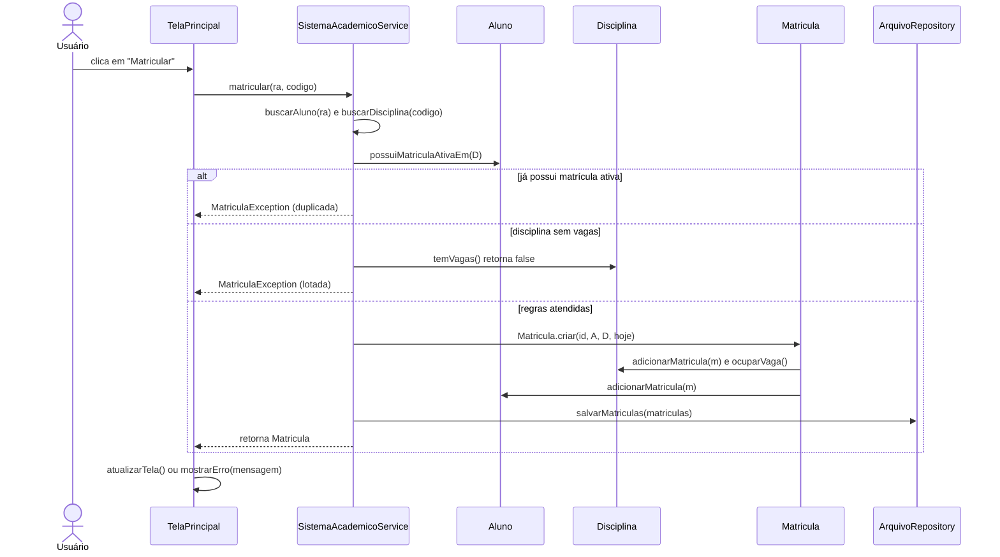
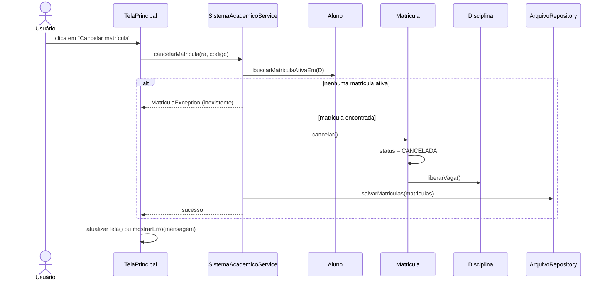

# 🏛️ ARCHITECTURE.md — Arquitetura do Sistema Acadêmico

> **Fonte da verdade** para a implementação. Toda assinatura, atributo e regra descrita aqui
> deve ser refletida no código. Se o código precisar divergir, **atualize este documento primeiro**
> (princípio do *Spec-Driven Development*).

---

## 1. Visão Geral em Camadas

O sistema é dividido em 5 pacotes com **dependências em sentido único** (de cima para baixo):



| Pacote | Pode depender de | **Nunca** depende de |
|---|---|---|
| `model` | apenas `java.util`, `java.time` | `service`, `repository`, `view`, `javax.swing`, `java.io`, `java.nio` |
| `repository` | `model`, `java.nio`, `java.io`, `java.util`, `java.time` | `service`, `view`, `javax.swing` |
| `service` | `model`, `repository`, `java.util`, `java.time`, `java.io` (só `IOException`) | `view`, `javax.swing` |
| `view` | `service`, `model` (somente **leitura**: getters/`toString`) | `repository`, `java.io`, `java.nio` |
| `app` | todos os pacotes | — |

---

## 2. Inventário de Arquivos (9 de no máximo 10)

| # | Arquivo | Pacote | Tipo | Responsabilidade em uma frase |
|---|---|---|---|---|
| 1 | `Aluno.java` | `model` | classe | Representa o aluno e conhece **suas** matrículas. |
| 2 | `Disciplina.java` | `model` | classe | Representa a disciplina, controla **suas** vagas e conhece suas matrículas. |
| 3 | `Matricula.java` | `model` | classe associativa (+ enum aninhado `Status`) | Liga **um** aluno a **uma** disciplina e guarda os dados do vínculo (data, status). |
| 4 | `MatriculaException.java` | `service` | exceção verificada | Comunica violações de regras de negócio com mensagens amigáveis. |
| 5 | `SistemaAcademicoService.java` | `service` | classe | Orquestra os casos de uso e aplica as regras de negócio. |
| 6 | `ArquivoRepository.java` | `repository` | classe | Lê e grava CSV e gera o *seed* inicial. |
| 7 | `TelaPrincipal.java` | `view` | `JFrame` | Exibe dados e captura ações do usuário. |
| 8 | `Main.java` | `app` | classe | Monta os objetos (*composition root*) e abre a janela. |
| 9 | `CasosDeTesteRunner.java` | `app` | classe | Executa cenários de teste e imprime relatório formatado. |

> O pacote `app` existe apenas para os **pontos de entrada** (`main`). Assim, nenhuma camada de
> negócio precisa conhecer Swing nem o console de testes.

---

## 3. Diagrama de Classes UML Completo

Legenda de visibilidade: `+` público · `-` privado · `~` pacote (*package-private*) · `$` estático.

```mermaid
classDiagram
    class Aluno {
        -String ra
        -String nome
        -List~Matricula~ matriculas
        +Aluno(String ra, String nome)
        +getRa() String
        +getNome() String
        +getMatriculas() List~Matricula~
        +getDisciplinasAtivas() List~Disciplina~
        +buscarMatriculaAtivaEm(Disciplina disciplina) Optional~Matricula~
        +possuiMatriculaAtivaEm(Disciplina disciplina) boolean
        ~adicionarMatricula(Matricula matricula) void
        +equals(Object o) boolean
        +hashCode() int
        +toString() String
    }

    class Disciplina {
        -String codigo
        -String nome
        -int limiteVagas
        -int vagasOcupadas
        -List~Matricula~ matriculas
        +Disciplina(String codigo, String nome, int limiteVagas)
        +getCodigo() String
        +getNome() String
        +getLimiteVagas() int
        +getVagasOcupadas() int
        +getVagasDisponiveis() int
        +temVagas() boolean
        +getMatriculas() List~Matricula~
        +getMatriculasAtivas() List~Matricula~
        ~adicionarMatricula(Matricula matricula) void
        ~liberarVaga() void
        -ocuparVaga() void
        +equals(Object o) boolean
        +hashCode() int
        +toString() String
    }

    class Matricula {
        -int id
        -Aluno aluno
        -Disciplina disciplina
        -LocalDate dataMatricula
        -Status status
        -Matricula(int id, Aluno aluno, Disciplina disciplina, LocalDate data)
        +criar(int id, Aluno aluno, Disciplina disciplina, LocalDate data)$ Matricula
        +cancelar() void
        +isAtiva() boolean
        +getId() int
        +getAluno() Aluno
        +getDisciplina() Disciplina
        +getDataMatricula() LocalDate
        +getStatus() Status
        +toString() String
    }

    class Status {
        <<enumeration>>
        ATIVA
        CANCELADA
    }

    class MatriculaException {
        +MatriculaException(String mensagem)
        +MatriculaException(String mensagem, Throwable causa)
    }

    class SistemaAcademicoService {
        -ArquivoRepository repositorio
        -Map alunosPorRa
        -Map disciplinasPorCodigo
        -List~Matricula~ matriculas
        -int proximoIdMatricula
        +SistemaAcademicoService(ArquivoRepository repositorio)
        +carregarDados() void
        +cadastrarAluno(String ra, String nome) Aluno
        +cadastrarDisciplina(String codigo, String nome, int limiteVagas) Disciplina
        +matricular(String ra, String codigoDisciplina) Matricula
        +cancelarMatricula(String ra, String codigoDisciplina) void
        +listarDisciplinasAtivas(String ra) List~Disciplina~
        +listarAlunos() List~Aluno~
        +listarDisciplinas() List~Disciplina~
        +listarMatriculas() List~Matricula~
        -buscarAluno(String ra) Aluno
        -buscarDisciplina(String codigo) Disciplina
        -persistirMatriculas() void
        -persistirAlunos() void
        -persistirDisciplinas() void
    }

    class ArquivoRepository {
        -String SEPARADOR$
        -String ARQ_ALUNOS$
        -String ARQ_DISCIPLINAS$
        -String ARQ_MATRICULAS$
        -List~String~ SEED_ALUNOS$
        -List~String~ SEED_DISCIPLINAS$
        -List~String~ SEED_MATRICULAS$
        -Path diretorio
        +ArquivoRepository(Path diretorio)
        +existemDados() boolean
        +gerarSeed() void
        +carregarAlunos() List~Aluno~
        +carregarDisciplinas() List~Disciplina~
        +carregarMatriculas(Map alunosPorRa, Map disciplinasPorCodigo) List~Matricula~
        +salvarAlunos(Collection~Aluno~ alunos) void
        +salvarDisciplinas(Collection~Disciplina~ disciplinas) void
        +salvarMatriculas(List~Matricula~ matriculas) void
        -lerLinhas(String nomeArquivo) List~String~
        -escreverLinhas(String nomeArquivo, List~String~ linhas) void
    }

    class TelaPrincipal {
        -SistemaAcademicoService service
        -JComboBox~Aluno~ comboAlunos
        -JComboBox~Disciplina~ comboDisciplinas
        -DefaultListModel~Disciplina~ modeloDisciplinasAtivas
        -DefaultTableModel modeloOcupacao
        -JLabel barraStatus
        +TelaPrincipal(SistemaAcademicoService service)
        -montarLayout() void
        -aoMatricular() void
        -aoCancelar() void
        -aoNovoAluno() void
        -aoNovaDisciplina() void
        -atualizarTela() void
        -atualizarDisciplinasDoAluno() void
        -atualizarTabelaOcupacao() void
        -mostrarSucesso(String mensagem) void
        -mostrarErro(String mensagem) void
    }

    class Main {
        +main(String[] args)$ void
    }

    class CasosDeTesteRunner {
        -int aprovados$
        -int reprovados$
        -List~String~ detalhesDoCaso$
        -List~String~ linhasTabela$
        +main(String[] args)$ void
        -executarCaso(String id, String titulo, Teste teste)$ void
        -registrar(String rotulo, String valor)$ void
        -verificar(boolean condicao, String mensagemFalha)$ void
        -esperarExcecao(Teste acao)$ MatriculaException
        -verificarInvariantes(SistemaAcademicoService service)$ void
        -imprimirResumo()$ void
    }

    %% ===== Associações do domínio (bidirecionais) =====
    Aluno "1" -- "0..*" Matricula : possui
    Disciplina "1" -- "0..*" Matricula : recebe
    Matricula --> "1" Status : status

    %% ===== Camada de serviço =====
    SistemaAcademicoService "1" o-- "0..*" Aluno : gerencia
    SistemaAcademicoService "1" o-- "0..*" Disciplina : gerencia
    SistemaAcademicoService "1" o-- "0..*" Matricula : registra
    SistemaAcademicoService --> "1" ArquivoRepository : persiste via
    SistemaAcademicoService ..> MatriculaException : lança
    Exception <|-- MatriculaException

    %% ===== Persistência =====
    ArquivoRepository ..> Aluno : lê
    ArquivoRepository ..> Disciplina : lê
    ArquivoRepository ..> Matricula : reconstrói e grava

    %% ===== Apresentação e entrada =====
    JFrame <|-- TelaPrincipal
    TelaPrincipal --> "1" SistemaAcademicoService : usa
    Main ..> SistemaAcademicoService : cria
    Main ..> ArquivoRepository : cria
    Main ..> TelaPrincipal : cria
    CasosDeTesteRunner ..> SistemaAcademicoService : testa
```



**Notas sobre o diagrama**

- `Map alunosPorRa` é `Map<String, Aluno>` e `Map disciplinasPorCodigo` é `Map<String, Disciplina>`
  (ambos `LinkedHashMap` para preservar a ordem de cadastro). O Mermaid não renderiza genéricos com vírgula.
- `Status` é um **enum aninhado** em `Matricula` (`Matricula.Status`), por isso não ocupa arquivo próprio.
- `Teste` é uma **interface funcional privada aninhada** em `CasosDeTesteRunner`
  (`void executar() throws Exception`), também sem arquivo próprio.
- A linha simples `--` entre `Aluno`/`Disciplina` e `Matricula` representa associação **navegável nos dois sentidos**.

### 3.1 Diagrama Simplificado do Domínio (para o relatório)



Leitura das multiplicidades:

- **Um** `Aluno` possui **zero ou mais** (`0..*`) `Matricula`s; cada `Matricula` pertence a **exatamente um** (`1`) `Aluno`.
- **Uma** `Disciplina` recebe **zero ou mais** (`0..*`) `Matricula`s; cada `Matricula` refere-se a **exatamente uma** (`1`) `Disciplina`.
- Logicamente, `Aluno` ↔ `Disciplina` é **muitos-para-muitos** (`0..*` ↔ `0..*`), decomposto pela classe associativa `Matricula`.

---

## 4. Responsabilidades de Cada Classe

### 4.1 `model.Aluno`

| Aspecto | Descrição |
|---|---|
| **Responsabilidade** | Representar um aluno e manter a lista das **suas** matrículas (ativas e canceladas). |
| **Identidade** | `ra` (Registro Acadêmico). `equals`/`hashCode` baseados **somente** no `ra`. |
| **Encapsulamento** | `getMatriculas()` retorna `Collections.unmodifiableList(...)`. Ninguém fora do pacote `model` consegue adicionar ou remover matrículas diretamente. |
| **Vínculo** | `adicionarMatricula(...)` é **package-private** (`~`): só `Matricula.criar(...)` o chama. |
| **Consultas** | `getDisciplinasAtivas()` percorre as matrículas e devolve as disciplinas cujas matrículas estão `ATIVA`, na ordem de matrícula. `buscarMatriculaAtivaEm(d)` devolve `Optional<Matricula>`; `possuiMatriculaAtivaEm(d)` usa o método anterior. |
| **Validação** | Construtor rejeita `ra`/`nome` nulos ou vazios com `IllegalArgumentException`. |
| **`toString()`** | `"2024001 - Ana Souza"` (usado diretamente pelo `JComboBox`). |

### 4.2 `model.Disciplina`

| Aspecto | Descrição |
|---|---|
| **Responsabilidade** | Representar uma disciplina, **controlar suas vagas** e manter a lista das suas matrículas. |
| **Identidade** | `codigo`. `equals`/`hashCode` baseados **somente** no `codigo`. |
| **Vagas** | `vagasOcupadas` **não é persistido**: é recalculado ao reconstruir as matrículas. Só muda via `ocuparVaga()` (privado, chamado por `adicionarMatricula`) e `liberarVaga()` (package-private, chamado por `Matricula.cancelar()`). |
| **Defesa** | `ocuparVaga()` lança `IllegalStateException` se `vagasOcupadas >= limiteVagas`; `liberarVaga()` lança `IllegalStateException` se `vagasOcupadas == 0`. São proteções de **último nível** — a regra amigável fica no service. |
| **Consultas** | `temVagas()` ⇔ `vagasOcupadas < limiteVagas`; `getVagasDisponiveis()` = `limiteVagas - vagasOcupadas`; `getMatriculasAtivas()` filtra por status. |
| **Validação** | Construtor rejeita `codigo`/`nome` vazios e `limiteVagas <= 0`. |
| **`toString()`** | `"POO101 - Programação Orientada a Objetos (3/30)"`. |

### 4.3 `model.Matricula` (classe associativa)

| Aspecto | Descrição |
|---|---|
| **Responsabilidade** | Representar o **vínculo** entre um aluno e uma disciplina e guardar os dados que pertencem ao vínculo e não a nenhum dos lados: `dataMatricula` e `status`. |
| **Criação** | Construtor **privado**. A única forma de criar é a *factory* `Matricula.criar(id, aluno, disciplina, data)`, que: (1) constrói o objeto com status `ATIVA`; (2) chama `disciplina.adicionarMatricula(m)` (que ocupa a vaga e **pode recusar** com `IllegalStateException` se estiver lotada); (3) só então chama `aluno.adicionarMatricula(m)`. Essa ordem garante que, se a disciplina recusar, **nenhum** lado fica com vínculo — é impossível existir uma matrícula "meio ligada". |
| **Por que factory?** | Evita publicar `this` dentro do construtor (*this-escape*) e concentra o vínculo bidirecional em **um único ponto** do código. |
| **Cancelamento** | `cancelar()`: se já estiver `CANCELADA`, lança `IllegalStateException`; senão muda o status para `CANCELADA` e chama `disciplina.liberarVaga()`. A matrícula **permanece** nas listas do aluno e da disciplina como **histórico** (*soft delete*). |
| **Imutabilidade parcial** | `id`, `aluno`, `disciplina` e `dataMatricula` são `final`. Apenas `status` muda, e somente no sentido `ATIVA → CANCELADA`. |
| **`toString()`** | `"#9 Elisa Ferreira -> POO101 [ATIVA]"`. |

Ciclo de vida de uma matrícula:



### 4.4 `service.MatriculaException`

- Estende `Exception` (**exceção verificada**): o compilador **obriga** a `view` e o runner a tratarem as falhas de regra de negócio — ótimo ponto didático.
- Mensagens sempre em português, amigáveis e com contexto (ver seção 6).

### 4.5 `service.SistemaAcademicoService`

| Aspecto | Descrição |
|---|---|
| **Responsabilidade** | Ser a **fachada** dos casos de uso: cadastrar entidades, localizar entidades, aplicar regras de negócio, acionar o modelo e solicitar a persistência. |
| **Estado** | `alunosPorRa` e `disciplinasPorCodigo` (`LinkedHashMap`), `matriculas` (`ArrayList`, registro global) e `proximoIdMatricula`. |
| **`carregarDados()`** | Se `!repositorio.existemDados()`, chama `repositorio.gerarSeed()`. Depois carrega alunos → disciplinas → matrículas (nesta ordem, pois matrículas dependem dos dois) e define `proximoIdMatricula = maior id + 1` (ou `1` se não houver matrículas). Declara `throws IOException`. |
| **`cadastrarAluno(ra, nome)`** | Valida se `ra` ou `nome` são nulos/em branco; verifica duplicidade no mapa de alunos (`alunosPorRa.containsKey(ra)`); cria `Aluno`, insere no mapa, chama `persistirAlunos()` e retorna o aluno cadastrado. |
| **`cadastrarDisciplina(codigo, nome, limiteVagas)`** | Valida `codigo` e `nome` (não nulos/em branco); valida `limiteVagas > 0`; verifica duplicidade (`disciplinasPorCodigo.containsKey(codigo)`); cria `Disciplina`, insere no mapa, chama `persistirDisciplinas()` e retorna a disciplina cadastrada. |
| **`matricular(ra, codigo)`** | Ordem fixa de verificação: (1) aluno existe; (2) disciplina existe; (3) **não duplicada**; (4) **há vagas**. Só então `Matricula.criar(proximoIdMatricula++, aluno, disciplina, LocalDate.now())`, adiciona à lista global e chama `persistirMatriculas()`. Retorna a matrícula criada. |
| **`cancelarMatricula(ra, codigo)`** | Localiza aluno e disciplina; obtém `aluno.buscarMatriculaAtivaEm(disciplina)`; se vazio, lança `MatriculaException`; senão `matricula.cancelar()` e `persistirMatriculas()`. |
| **`listarDisciplinasAtivas(ra)`** | Localiza o aluno e devolve `aluno.getDisciplinasAtivas()`. |
| **Listagens** | `listarAlunos()`, `listarDisciplinas()`, `listarMatriculas()` devolvem **cópias não modificáveis** (`List.copyOf(...)`). |
| **Persistência** | `persistirMatriculas()`, `persistirAlunos()`, `persistirDisciplinas()` delegam ao repositório e convertem qualquer `IOException` em `MatriculaException("Falha ao salvar os dados: ...", causa)`. |
| **Não faz** | Não imprime no console, não abre janelas, não conhece Swing. |

> **Por que a regra de duplicidade vem antes da regra de vagas?** Se um aluno já matriculado
> tentar se matricular de novo numa disciplina lotada, a mensagem correta é "já possui matrícula",
> e não "disciplina lotada".

### 4.6 `repository.ArquivoRepository`

| Aspecto | Descrição |
|---|---|
| **Responsabilidade** | Traduzir objetos ↔ linhas CSV e criar os dados iniciais. Nenhuma regra de negócio. |
| **Diretório** | Recebido no construtor (`Path`). A aplicação usa `Path.of("dados")`; os testes usam um diretório temporário. |
| **I/O** | Somente `java.nio.file.Files` (`readAllLines`, `write`, `createDirectories`, `exists`) com `StandardCharsets.UTF_8` explícito. |
| **`existemDados()`** | `true` se os **três** arquivos existirem. |
| **`gerarSeed()`** | Cria o diretório e grava os três arquivos a partir das constantes `SEED_ALUNOS`, `SEED_DISCIPLINAS` e `SEED_MATRICULAS` (listas de linhas CSV **já com cabeçalho**, dados da seção 7.3). Assim, o seed passa pelo **mesmo parser** dos dados reais. |
| **`carregarMatriculas(...)`** | Para cada linha: busca aluno e disciplina nos mapas (se não encontrar, lança `IOException` com número da linha); chama `Matricula.criar(...)`; se o status for `CANCELADA`, chama `cancelar()` **imediatamente** — isso reproduz fielmente a contagem de vagas. |
| **`salvarAlunos(...)`** | Grava o cabeçalho `ra;nome` seguido de cada aluno formatado em CSV em `alunos.csv`. |
| **`salvarDisciplinas(...)`** | Grava o cabeçalho `codigo;nome;limiteVagas` seguido de cada disciplina em `disciplinas.csv`. |
| **`salvarMatriculas(...)`** | Grava o cabeçalho `id;ra;codigoDisciplina;data;status` seguido de cada matrícula em `matriculas.csv`. |
| **Formato** | Cabeçalho na primeira linha (ignorado na leitura), separador `;`, linhas em branco ignoradas. |

### 4.7 `view.TelaPrincipal`

Janela única (`JFrame`, ~920×540, centralizada, `EXIT_ON_CLOSE`, título `"Sistema Acadêmico — Matrículas"`):

```text
┌────────────────────────────────────────────────────────────────────────────────────────┐
│ Aluno: [2024005 - Elisa Ferreira ▼]  Disciplina: [POO101 - ... (3/30) ▼]              │
│ [ Matricular ]  [ Cancelar matrícula ]   [ + Novo Aluno ]   [ + Nova Disciplina ]      │
├────────────────────────────┬───────────────────────────────────────────────────────────┤
│ Disciplinas ativas do aluno│ Ocupação das disciplinas                                  │
│ ┌────────────────────────┐ │ Código │ Nome          │ Ocup. │ Lim. │ Situação          │
│ │ POO101 - Programação...│ │ POO101 │ Programação...│   4   │  30  │ Disponível        │
│ │                        │ │ LAB401 │ Laboratório...│   2   │   2  │ LOTADA            │
│ └────────────────────────┘ │                                                           │
├────────────────────────────┴───────────────────────────────────────────────────────────┤
│ Status: Matrícula #9 realizada: Elisa Ferreira -> POO101                                │
└────────────────────────────────────────────────────────────────────────────────────────┘
```

- Trocar o aluno no combo atualiza a lista de disciplinas ativas.
- Botões **"Novo Aluno"** e **"Nova Disciplina"**: acionam caixas de diálogo simples com `JOptionPane.showInputDialog` para coletar os campos necessários (RA e nome para aluno; código, nome e limite de vagas para disciplina), chamam o respectivo método no service e atualizam a tela sem necessidade de novas classes ou formulários complexos.
- Botões chamam **apenas** métodos públicos do service; `MatriculaException` vira `JOptionPane` de erro.
- Clicar numa disciplina da lista de ativas seleciona-a no combo de disciplinas (facilita o cancelamento).
- Após qualquer operação: `atualizarTela()` recarrega combos (preservando a seleção), lista e tabela.
- A tabela não é editável (sobrescrever `isCellEditable` retornando `false`).

### 4.8 `app.Main`

1. Cria `ArquivoRepository(Path.of("dados"))` e `SistemaAcademicoService(repositorio)`.
2. Chama `service.carregarDados()`; em caso de `IOException`, mostra `JOptionPane` de erro e encerra.
3. Abre a janela com `SwingUtilities.invokeLater(() -> new TelaPrincipal(service).setVisible(true))`.

### 4.9 `app.CasosDeTesteRunner`

- Cria um diretório temporário (`Files.createTempDirectory("academico-teste")`), gerando um *seed* limpo e **determinístico**.
- Executa os casos CT01–CT13 (definidos em `TASKS.md`, Etapa 4) em sequência — **o estado é compartilhado** entre os casos, formando uma narrativa.
- Após cada caso, chama `verificarInvariantes(...)` (seção 5).
- Auxiliares: `registrar(rotulo, valor)` acumula as linhas *Entrada/Esperado/Obtido/Estado* do caso;
  `verificar(condicao, mensagem)` lança `AssertionError` se a condição for falsa (**não** usar a palavra-chave
  `assert`, desabilitada por padrão na JVM); `esperarExcecao(acao)` executa a ação e devolve a
  `MatriculaException` capturada — ou falha se nenhuma exceção ocorrer.
- Um caso termina como `PASSOU` se `teste.executar()` concluir sem erro; `AssertionError` ou qualquer outra
  exceção resulta em `FALHOU`, sem interromper os casos seguintes.
- Imprime um bloco detalhado por caso e, ao final, um resumo e uma **tabela Markdown** para o relatório.
- Termina com `System.exit(reprovados == 0 ? 0 : 1)`.

---

## 5. Consistência em Memória — Invariantes

As **invariantes** são verdades que devem valer **antes e depois de toda operação pública**.

| ID | Invariante | Quem garante |
|---|---|---|
| **I1** | Toda `Matricula m` está em `m.getAluno().getMatriculas()` **e** em `m.getDisciplina().getMatriculas()`. | `Matricula.criar(...)` (único ponto de vínculo) + listas não modificáveis. |
| **I2** | `disciplina.getVagasOcupadas()` == número de matrículas `ATIVA` da disciplina. | `Disciplina.adicionarMatricula` (ocupa) + `Matricula.cancelar` (libera). |
| **I3** | `0 <= vagasOcupadas <= limiteVagas`. | Service (regra amigável) + `ocuparVaga`/`liberarVaga` (defesa). |
| **I4** | Existe no máximo **uma** matrícula `ATIVA` por par (aluno, disciplina). | Service (`possuiMatriculaAtivaEm`). |
| **I5** | Uma matrícula `CANCELADA` nunca volta a `ATIVA`. | `Matricula.cancelar()` + ausência de método "reativar". |
| **I6** | Os `id`s de matrícula são únicos e crescentes. | `proximoIdMatricula` no service. |

### 5.1 Mecanismos que protegem as invariantes

1. **Ponto único de vínculo** — só `Matricula.criar(...)` liga os três objetos.
2. **Visibilidade de pacote** — `adicionarMatricula` e `liberarVaga` são `~` (package-private): `service` e `view` **não conseguem** chamá-los.
3. **Coleções não modificáveis** — `getMatriculas()` devolve visão somente-leitura; tentar `add`/`remove` lança `UnsupportedOperationException` (testado no CT12).
4. **Campos `final`** — referências a aluno e disciplina nunca mudam depois de criadas.
5. **Defesa em profundidade** — o service valida e explica; o model recusa estados inválidos com `IllegalStateException`.

### 5.2 Sequência — Realizar Matrícula



### 5.3 Sequência — Cancelar Matrícula



---

## 6. Regras de Negócio e Mensagens Padronizadas

As mensagens abaixo são **contrato**: os testes e a interface dependem delas.

| Situação | Onde é verificada | Mensagem (`MatriculaException`) |
|---|---|---|
| RA inexistente, nulo ou vazio | `buscarAluno` | `Aluno com RA '<ra>' não encontrado.` |
| Código inexistente, nulo ou vazio | `buscarDisciplina` | `Disciplina com código '<codigo>' não encontrada.` |
| **Matrícula duplicada** | `matricular` | `O aluno <nome> já possui matrícula ativa em <codigo>.` |
| **Disciplina lotada** | `matricular` | `A disciplina <codigo> está lotada (<ocupadas>/<limite> vagas ocupadas).` |
| Cancelar sem matrícula ativa | `cancelarMatricula` | `O aluno <nome> não possui matrícula ativa em <codigo>.` |
| **RA já cadastrado** | `cadastrarAluno` | `Aluno com RA '<ra>' já está cadastrado.` |
| **Código de disciplina já cadastrado** | `cadastrarDisciplina` | `Disciplina com código '<codigo>' já está cadastrada.` |
| RA nulo ou vazio ao cadastrar | `cadastrarAluno` | `O RA do aluno não pode ser nulo ou vazio.` |
| Nome nulo ou vazio ao cadastrar | `cadastrarAluno` | `O nome do aluno não pode ser nulo ou vazio.` |
| Código nulo ou vazio ao cadastrar | `cadastrarDisciplina` | `O código da disciplina não pode ser nulo ou vazio.` |
| Nome nulo ou vazio ao cadastrar | `cadastrarDisciplina` | `O nome da disciplina não pode ser nulo ou vazio.` |
| Limite de vagas inválido (<= 0) | `cadastrarDisciplina` | `O limite de vagas deve ser maior que zero.` |
| Falha de I/O ao salvar | `persistirMatriculas` / `persistirAlunos` / `persistirDisciplinas` | `Falha ao salvar os dados: <mensagem da IOException>` |

Exemplos reais com o seed: `O aluno Ana Souza já possui matrícula ativa em POO101.` ·
`A disciplina LAB401 está lotada (2/2 vagas ocupadas).` · `Aluno com RA '2024001' já está cadastrado.`

---

## 7. Persistência em CSV

### 7.1 Arquivos (em `dados/`, UTF-8, separador `;`)

| Arquivo | Cabeçalho | Exemplo |
|---|---|---|
| `alunos.csv` | `ra;nome` | `2024001;Ana Souza` |
| `disciplinas.csv` | `codigo;nome;limiteVagas` | `LAB401;Laboratório de Robótica;2` |
| `matriculas.csv` | `id;ra;codigoDisciplina;data;status` | `6;2024003;ED301;2026-02-12;CANCELADA` |

- `vagasOcupadas` **não** é gravado: é derivado das matrículas ativas (evita dado redundante e inconsistente).
- Datas no formato ISO (`LocalDate.toString()` / `LocalDate.parse()`).
- Em tempo de execução, `matriculas.csv` é regravado a cada matrícula ou cancelamento, e `alunos.csv` e `disciplinas.csv` são atualizados sempre que um novo aluno ou disciplina for cadastrado.

### 7.2 Algoritmo de carga

```text
1. se faltar algum dos 3 arquivos → gerarSeed()
2. alunos      ← ler alunos.csv        → LinkedHashMap por RA
3. disciplinas ← ler disciplinas.csv   → LinkedHashMap por código (vagasOcupadas = 0)
4. para cada linha de matriculas.csv, em ordem:
       m ← Matricula.criar(id, aluno, disciplina, data)   // vincula e ocupa vaga
       se status == CANCELADA → m.cancelar()              // libera a vaga
5. proximoIdMatricula ← maior id + 1
```

### 7.3 Dados do seed

Idênticos à seção *Dados de Demonstração* do `README.md` (5 alunos, 4 disciplinas, 8 matrículas, sendo 7 ativas;
`LAB401` começa **lotada** com 2/2 e `Elisa Ferreira` começa **sem matrículas**).

---

## 8. Por que dividir responsabilidades? (Associações × Classe Única)

Alternativa ingênua: uma única classe `SistemaAcademico` com estruturas paralelas, por exemplo
`Map<String, List<String>> disciplinasPorAluno`, `Map<String, Integer> vagasPorDisciplina` e
`Map<String, String> statusPorParAlunoDisciplina`, além de toda a lógica de tela, regra e arquivo.

| Critério | Classe única "faz-tudo" | Classes associadas (este projeto) |
|---|---|---|
| **Coesão** | Baixa: uma classe mistura dados, regras, I/O e tela. | Alta: cada classe tem um único motivo para mudar. |
| **Consistência** | Estruturas paralelas podem divergir (vaga decrementada sem remover o vínculo, por exemplo). | Vínculo e contagem mudam juntos em um único ponto (`criar`/`cancelar`). |
| **Dados do vínculo** | Data e status da matrícula ficam "soltos" em mapas auxiliares indexados por strings compostas. | Pertencem naturalmente à classe associativa `Matricula`. |
| **Histórico** | Cancelar costuma significar apagar a informação. | Matrícula cancelada permanece como registro (*soft delete*). |
| **Testabilidade** | Difícil testar uma regra sem arrastar tela e arquivos. | Service testado no console, com repositório em diretório temporário. |
| **Evolução** | Adicionar "nota" ou "frequência" exige mais mapas paralelos. | Basta adicionar atributos em `Matricula`. |
| **Encapsulamento** | Qualquer método altera qualquer estrutura. | Visibilidade de pacote e listas não modificáveis impedem alterações indevidas. |
| **Trabalho em grupo** | Todos editam o mesmo arquivo (conflitos). | Cada integrante pode cuidar de uma camada. |

---

## 9. Decisões de Projeto (registro resumido)

| # | Decisão | Motivo |
|---|---|---|
| D1 | `Matricula` como classe associativa com *factory* `criar(...)` | Garante vínculo bidirecional atômico e evita *this-escape*. |
| D2 | Cancelamento = mudança de status (*soft delete*) | Preserva histórico e permite rematrícula com novo objeto. |
| D3 | `vagasOcupadas` mantido em memória, **não** persistido | Evita redundância; recalculado na carga. Mantém o nome exigido pela especificação. |
| D4 | `MatriculaException` verificada (`extends Exception`) | Força o tratamento das regras na interface (didático). |
| D5 | `Status` como enum aninhado em `Matricula` | Respeita o limite de arquivos e expressa que o status pertence à matrícula. |
| D6 | Separador `;` no CSV | Nomes em português podem conter vírgulas; `;` é padrão do Excel em pt-BR. |
| D7 | Repositório recebe o diretório no construtor | Permite testes isolados em diretório temporário. |
| D8 | Pacote `app` para os `main` | Mantém `view` e `service` livres de responsabilidades de inicialização. |
